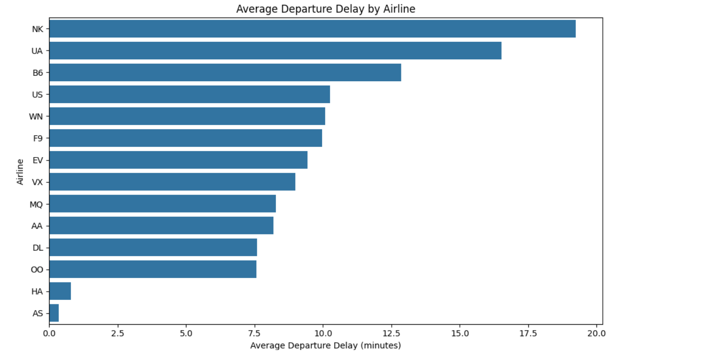
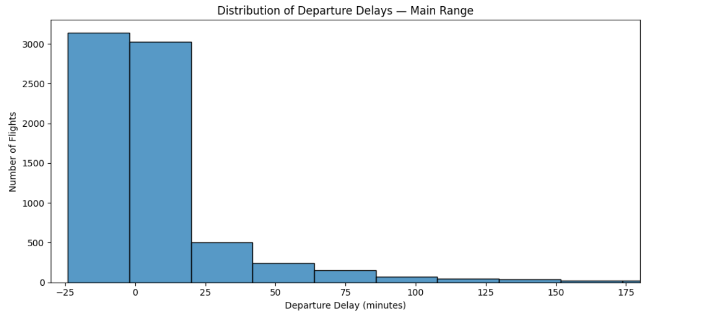
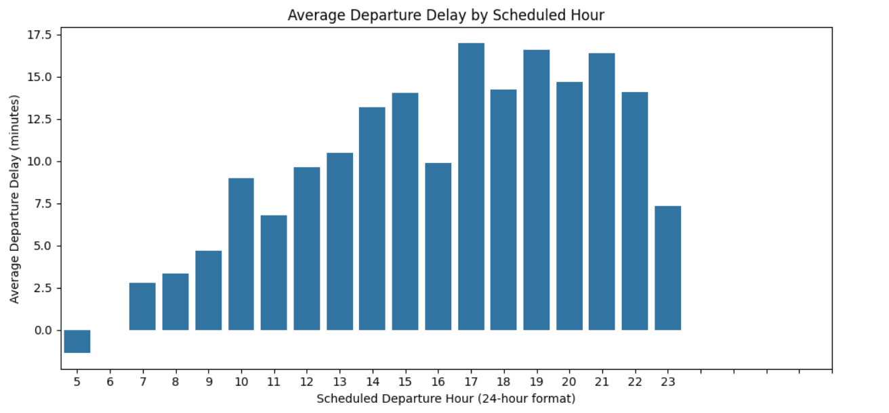
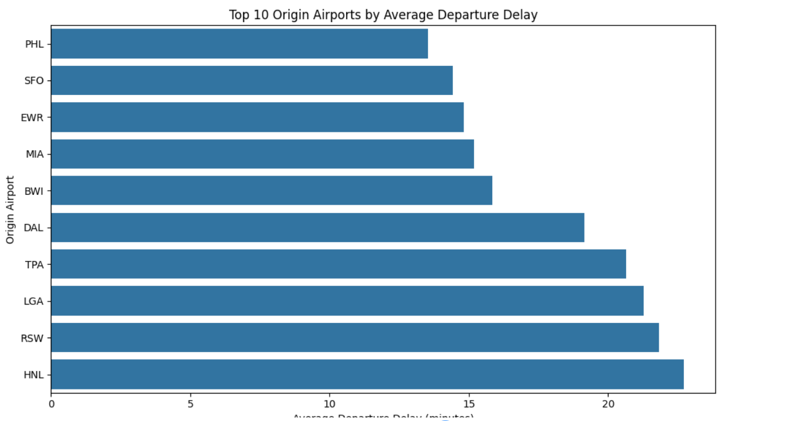
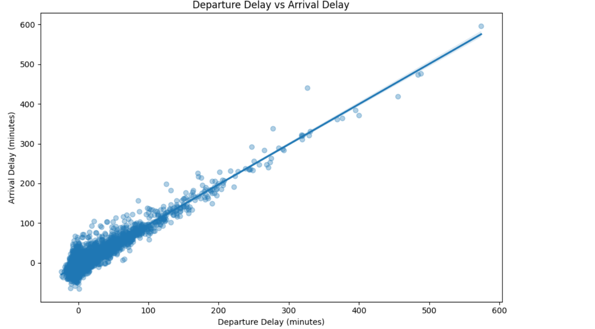

# Flight Delay Exploratory Data Analysis (EDA)

## Project Overview

This project explores flight delay data using Python and data visualization libraries. The objective is to identify patterns in departure delays, compare airlines and origin airports, and investigate relationships between departure delays, arrival delays, and flight distance.

## Objectives

- Inspect the dataset structure and data quality.
- Analyze the distribution of departure delays.
- Compare average departure delays across airlines.
- Investigate departure delays by scheduled departure hour.
- Identify origin airports with high average departure delays.
- Explore correlations between departure delays, arrival delays, and flight distance.
- Analyze changes in delays between departure and arrival.

## Tools and Technologies

- Python
- Pandas
- Matplotlib
- Seaborn
- Google Colab

## Key Findings

- Departure delays have a right-skewed distribution, with a small number of very large delays.
- Average departure delays vary across airlines and origin airports in the sample.
- Departure delays and arrival delays have a strong positive correlation.
- Flight distance has a very weak linear correlation with arrival delay in this dataset.
- Some flights arrive with a smaller delay than they had at departure.

## Project Workflow

1. Dataset loading and inspection
2. Data quality assessment
3. Exploratory data analysis
4. Statistical summaries and visualizations
5. Interpretation of findings
6. Conclusions and limitations

##  Visualizations

### 1. Average Departure Delay by Airline

### 2. Distribution of Departure Delays

### 3. Average Departure Delay by Scheduled Hour

### 4. Top 10 Origin Airports by Average Departure Delay

### 5. Departure Delay vs. Arrival Delay

## Limitations

This analysis uses a limited sample of flight records. Results may not generalize to all flights. Missing values, extreme delays, and differences in sample sizes may influence the findings. Correlation does not prove causation.

## Conclusion

This project demonstrates the use of Python-based exploratory data analysis to investigate operational data, summarize patterns, and communicate findings through visualizations.

### Dataset Attribution

This project uses a sample of the *2015 Flight Delays and Cancellations* dataset, originally published by the U.S. Department of Transportation and made available through Kaggle.

- **Dataset:** https://www.kaggle.com/datasets/usdot/flight-delays
- **Sample source:** https://gist.github.com/yinhao0424/4f81f1f1ac5907309772ae0181945b39
- **Original dataset license:** CC0, as listed on the Kaggle dataset page.

This project focuses on exploratory data analysis and does not claim ownership of the original dataset.
